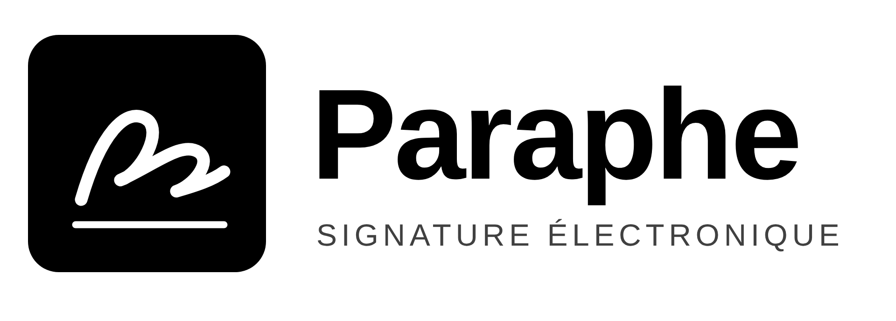
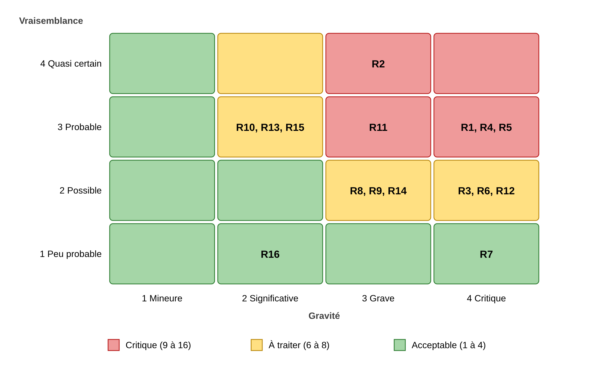
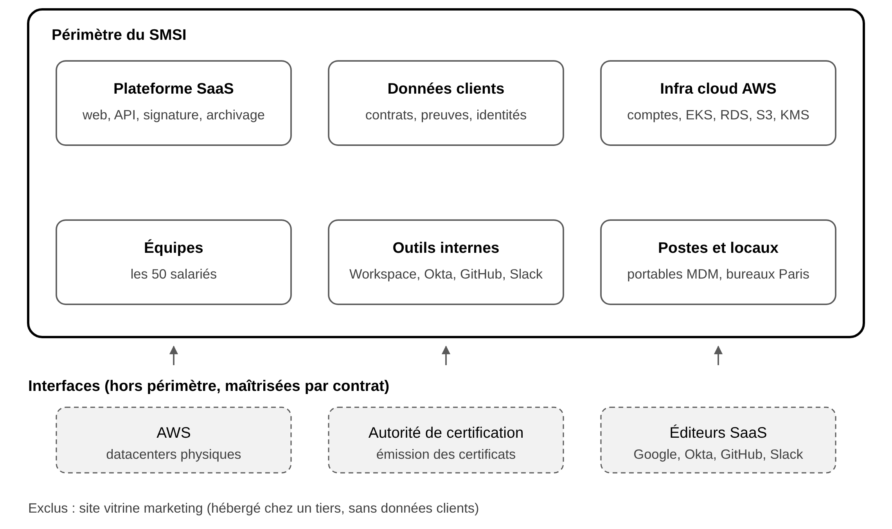

<p align="center">
  
</p>

<h1 align="center">Conception d'un SMSI conforme à ISO/IEC 27001:2022</h1>

<p align="center">
  Projet académique · EFREI Paris · ING2 Cybersécurité SI et Gouvernance (CSIG) · 2026-2027<br>
  <a href="rapport/Rapport_SMSI_Paraphe_Sam_DOSSOU.pdf"><b>Lire le rapport complet (PDF, 39 pages)</b></a>
</p>

---

## Le projet en bref

J'ai joué le rôle du **RSSI de Paraphe SAS**, une startup fictive de 50 salariés qui édite une plateforme SaaS B2B de signature électronique et de gestion des contrats, hébergée sur AWS. L'objectif était de concevoir un **Système de Management de la Sécurité de l'Information (SMSI)** complet, prêt pour un audit de certification ISO/IEC 27001:2022.

J'ai réalisé ce projet seul, dans le cadre du module ST2SSI (Sécurité des Systèmes d'Information) encadré par M. Alexandre Lopes.

| Chiffre clé | Valeur |
| --- | --- |
| Actifs inventoriés et évalués (CID) | 18 |
| Scénarios de risque cotés (ISO 27005) | 16, dont 5 critiques |
| Budget du plan de traitement (an 1) | 72 k€ |
| Mesures de l'Annexe A couvertes par la SoA | 93 (89 retenues, 4 exclues et justifiées) |
| Règles de la PSSI | 94, chacune reliée à une mesure de l'Annexe A |
| Procédures et formulaires | 4 procédures, 3 formulaires |

## Livrables

1. **Contexte et périmètre** (clauses 4 à 6) : enjeux internes et externes, 10 parties intéressées, énoncé de périmètre, rôles et 9 objectifs de sécurité mesurables.
2. **Analyse de risques ISO 27005** : échelles écrites à l'avance, inventaire des actifs, scénarios menace et vulnérabilité, carte thermique, plan de traitement (RTAE) et acceptation des risques résiduels.
3. **Déclaration d'applicabilité (SoA)** : les 93 mesures de l'Annexe A, avec motif (risque, loi, contrat ou bonne pratique), mise en œuvre et statut.
4. **PSSI** : 94 règles réparties en douze thèmes (accès, cloud AWS, développement sécurisé, cryptographie, fournisseurs, incidents, continuité).
5. **Procédures et formulaires** : arrivée et départ, gestion des incidents, revue des droits, sauvegarde et test de restauration.
6. **Simulation d'audit de certification** : 18 questions d'auditeur, réponses et preuves, constats et plan d'actions correctives.

## Aperçu

<p align="center">
  <br>
  <i>Carte thermique des 16 risques avant traitement</i>
</p>

<p align="center">
  <br>
  <i>Périmètre du SMSI et interfaces avec les prestataires</i>
</p>

## Démarche

J'ai suivi l'ordre de la norme : contexte et périmètre, puis appréciation et traitement des risques, puis Déclaration d'applicabilité, PSSI et procédures, et enfin vérification par un audit simulé. Chaque livrable réutilise le précédent, ce qui donne une **traçabilité complète** : chaque règle de la PSSI renvoie à une mesure de l'Annexe A, qui renvoie elle-même à un risque ou à une exigence légale (RGPD, eIDAS, NIS2).

## Référentiels utilisés

ISO/IEC 27001:2022 · ISO/IEC 27002:2022 · ISO/IEC 27005:2022 · RGPD · règlement eIDAS · directive NIS2

## Contenu du dépôt

```
rapport/    Rapport final mis en page (PDF)
sources/    Texte complet du rapport en Markdown, lisible directement sur GitHub
figures/    Schémas du rapport (périmètre, carte thermique, processus d'incident) et logo
```

## Avertissement

**Paraphe SAS est une entreprise fictive.** Toutes les données (effectifs, chiffres, incidents, résultats d'audit) ont été inventées pour les besoins de l'exercice, et la simulation d'audit décrit un scénario plausible, pas des résultats réels. Le logo de Paraphe a été créé pour ce projet. Les sujets et supports de cours de l'EFREI ne sont pas inclus dans ce dépôt.

---

## English summary

Academic project (EFREI Paris, MSc-level cybersecurity track). Acting as CISO of a fictitious 50-employee B2B e-signature SaaS company hosted on AWS, I designed a complete **ISO/IEC 27001:2022 ISMS**: context and scope, an **ISO 27005 risk assessment** (18 assets, 16 scenarios, €72k treatment plan), a **Statement of Applicability** covering all 93 Annex A controls, a 94-rule security policy, operational procedures, and a mock certification audit. All company data is fictitious. The report is written in French.

## Auteur

**Sam DOSSOU** · étudiant ingénieur en cybersécurité à l'EFREI Paris · GitHub [@Dkls7777](https://github.com/Dkls7777)

## Licence

Documentation sous licence [CC BY-NC 4.0](https://creativecommons.org/licenses/by-nc/4.0/deed.fr) : réutilisation libre à des fins non commerciales, avec mention de l'auteur.
