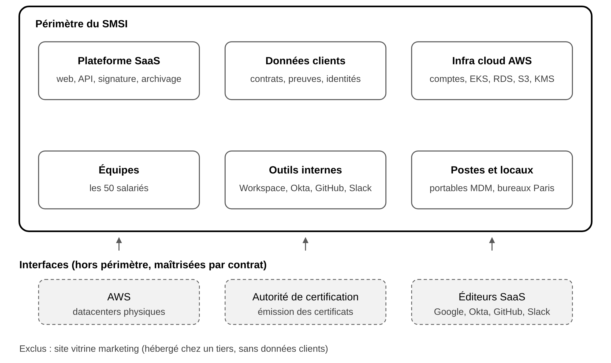
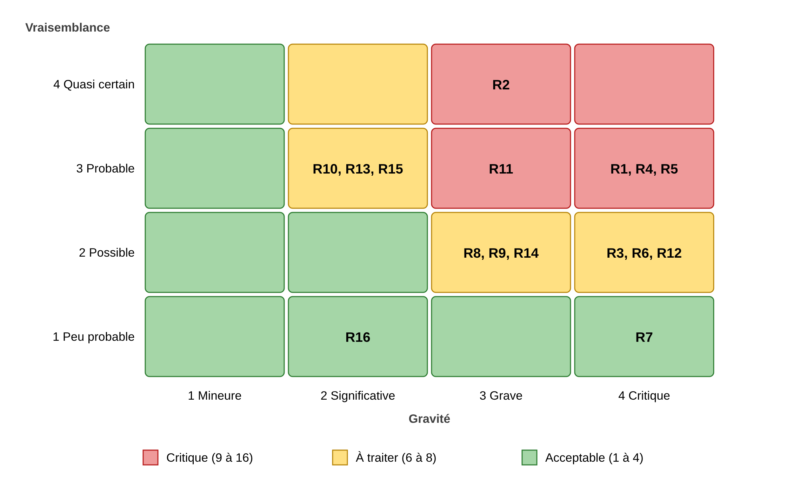
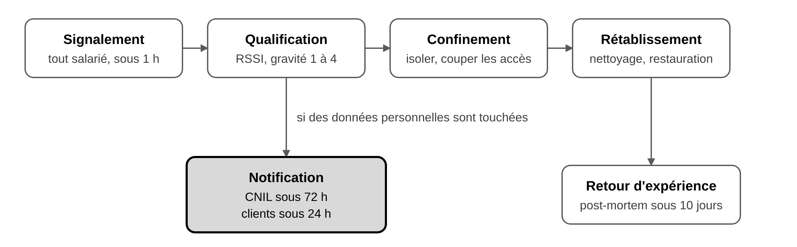

# Rapport de projet : conception d'un SMSI conforme à ISO/IEC 27001:2022

Sam DOSSOU, ING2 CSIG, EFREI Paris Panthéon-Assas Université, 2026-2027. Version Markdown du rapport ; la version mise en page est dans [`../rapport/`](../rapport/).

# 1. Introduction

## 1.1 Contexte

Ce rapport présente le projet 2 du module ST2SSI (Sécurité des Systèmes d'Information) encadré par M. Alexandre Lopes : la conception d'un Système de Management de la Sécurité de l'Information (SMSI) conforme à la norme ISO/IEC 27001:2022. La consigne demande de jouer le rôle du RSSI d'une startup technologique fictive de 50 salariés qui vend un logiciel en mode SaaS à des entreprises (B2B).

J'ai choisi d'imaginer Paraphe SAS, un éditeur de plateforme de signature électronique et de gestion des contrats. Dans ce secteur, la sécurité est au cœur du produit et les grands comptes exigent souvent la certification ISO 27001 de leurs fournisseurs : la démarche répond donc à un vrai besoin métier.

## 1.2 Objectifs

Les objectifs fixés par la fiche projet, que j'ai repris comme fil conducteur, sont les suivants :

- **Contexte et périmètre** : définir le contexte, les parties intéressées et le périmètre du SMSI ;
- **Analyse de risques** : évaluer les risques selon ISO 27005 et planifier leur traitement ;
- **Choix des mesures** : justifier les mesures de l'Annexe A dans une Déclaration d'applicabilité ;
- **Politique et procédures** : rédiger la PSSI, les procédures et les formulaires associés ;
- **Simulation d'audit** : confronter le SMSI aux questions d'un auditeur de certification.

## 1.3 Démarche

J'ai suivi l'ordre de la norme ISO 27001 : contexte et périmètre (clauses 4 et 5), appréciation et traitement des risques (clause 6), Déclaration d'applicabilité, PSSI et procédures, puis vérification par un audit (clauses 9 et 10). Chaque étape réutilise la précédente : les risques justifient les mesures de la SoA, et chaque règle de la PSSI renvoie à une mesure de l'Annexe A. C'est cette traçabilité qu'un auditeur vérifie en premier.

Mon rendu s'écarte de la consigne sur trois points, que je justifie ici :

- **Travail individuel** : le projet est prévu pour 2 à 7 personnes, je l'ai réalisé seul ;
- **Absence de soutenance** : aucune présentation orale n'étant prévue, j'ai rédigé la simulation d'audit (partie 8) ;
- **Entreprise fictive** : toutes les données de Paraphe SAS sont inventées, comme le demande la consigne.

# 2. Environnement de travail

Ce projet est documentaire : il ne repose pas sur une machine ou un logiciel à installer, mais sur des référentiels normatifs et sur des choix de méthode. Le tableau ci-dessous résume le cadre que j'ai utilisé.

| Élément | Configuration |
| --- | --- |
| Norme de référence du SMSI | ISO/IEC 27001:2022 (clauses 4 à 10 et Annexe A, 93 mesures en 4 thèmes) |
| Guide de mise en œuvre des mesures | ISO/IEC 27002:2022 |
| Méthode d'analyse de risques | ISO/IEC 27005:2022, approche par les actifs |
| Échelles d'évaluation | Critères CID notés de 1 à 4, vraisemblance et gravité de 1 à 4, criticité de 1 à 16 |
| Cadre réglementaire pris en compte | RGPD, règlement eIDAS (signature électronique), directive NIS2 |
| Organisation étudiée | Paraphe SAS, startup fictive de 50 salariés, hébergée sur AWS (région Paris) |
| Production des documents | Rapport au format .docx et .pdf, schémas réalisés en vectoriel |

# 3. Contexte, périmètre et objectifs du SMSI

## 3.1 Présentation de Paraphe SAS

Paraphe SAS est une startup fictive de 50 salariés qui édite une plateforme SaaS B2B de signature électronique et de gestion du cycle de vie des contrats. Créée en 2021 à Paris, elle sert environ 800 entreprises clientes (PME et ETI européennes) et vise la certification ISO 27001:2022 pour répondre aux appels d'offres des grands comptes. Son offre comprend quatre services :

- **Signature électronique** : signature simple et avancée au sens du règlement eIDAS, via une autorité de certification partenaire qualifiée ;
- **Gestion des contrats** : modèles, circuits de validation, relances et tableau de bord des échéances ;
- **Archivage à valeur probante** : conservation des documents signés et des preuves de signature (horodatage, journal d'audit) ;
- **API publique** : intégration de la signature dans les outils des clients (CRM, SIRH, ERP).

Pour lui donner une taille réaliste, j'ai fixé ses chiffres clés : environ 400 000 documents signés par mois, un chiffre d'affaires d'environ 6 M€, une levée de fonds de Série A de 12 M€ en 2024, et un siège à Paris avec trois jours de télétravail par semaine. L'organisation compte huit services. Je l'ai construite pour que l'équipe sécurité soit volontairement petite (2 personnes), ce qui est typique d'une startup et oblige à des mesures proportionnées.

| Service | Effectif | Rôle |
| --- | --- | --- |
| Direction | 3 | CEO, CTO, COO |
| Tech et R&D | 20 | Développement (14), SRE / DevOps (4), Data (2) |
| Ventes | 9 | Commerciaux grands comptes et PME |
| Customer Success et Support | 6 | Onboarding et support client de niveau 1 et 2 |
| Produit et Design | 4 | Product managers, UX |
| Finance, RH, Administration | 4 | Comptabilité, paie, juridique |
| Sécurité et Conformité | 2 | RSSI, analyste sécurité et DPO |
| Marketing | 2 | Acquisition, site vitrine |

Le système d'information repose entièrement sur le cloud et sur des services SaaS :

- **Production** : AWS région Paris (eu-west-3), cluster Kubernetes (EKS), bases PostgreSQL (RDS), documents chiffrés sur S3 avec des clés gérées par AWS KMS ;
- **Secours** : sauvegardes répliquées sur AWS Francfort (eu-central-1) ;
- **Outils internes** : Google Workspace, Okta (SSO et MFA), Slack, GitHub (code et CI/CD), Jira, HubSpot (CRM) ;
- **Postes de travail** : ordinateurs portables macOS gérés par un MDM, aucun serveur dans les locaux ;
- **Prestataires clés** : AWS, l'autorité de certification partenaire, Okta et Google.

## 3.2 Enjeux internes et externes (clause 4.1)

La clause 4.1 demande d'identifier les enjeux qui influencent la capacité du SMSI à atteindre ses objectifs. J'ai conclu que l'enjeu principal de Paraphe est la confiance : le SMSI doit protéger en priorité la confidentialité et l'intégrité des documents et des preuves de signature. Le premier tableau présente les enjeux externes.

| Enjeu externe | Conséquence pour le SMSI |
| --- | --- |
| Les grands comptes exigent ISO 27001 dans leurs appels d'offres | Certification nécessaire pour la croissance commerciale |
| Règlement eIDAS (signature électronique) | Intégrité des preuves, horodatage, traçabilité des signatures |
| RGPD : Paraphe est sous-traitant de ses clients | Clauses de l'article 28, registre des traitements, notification des violations sous 72 h |
| Directive NIS2 : fournisseur de services numériques de taille moyenne | Assujettissement possible comme entité importante, à confirmer |
| Concurrence forte (DocuSign, Yousign) | La sécurité devient un argument de différenciation |
| Menaces visant le SaaS : rançongiciels, hameçonnage, attaques de la chaîne d'approvisionnement | Mesures techniques et sensibilisation prioritaires |

Le second tableau présente les enjeux internes, qui viennent surtout de la culture et de la croissance rapide de la startup.

| Enjeu interne | Conséquence pour le SMSI |
| --- | --- |
| Croissance rapide après la Série A (recrutements fréquents) | Processus d'arrivée et de départ formalisés, gestion des accès |
| Culture startup : sécurité peu documentée, pratiques informelles | Rédaction de la PSSI et des procédures, preuves d'application |
| Dépendance forte à AWS et à quelques prestataires | Gestion des fournisseurs, plan de continuité |
| Télétravail 3 jours par semaine, 100 % des postes nomades | Sécurisation des postes, MDM, accès via SSO et MFA |
| Équipe sécurité réduite (2 personnes) | Mesures proportionnées, automatisation, implication de la direction |

## 3.3 Parties intéressées (clause 4.2)

J'ai identifié dix parties intéressées qui ont des exigences de sécurité envers Paraphe. Toutes sont prises en compte par le SMSI, comme le détaille le tableau suivant.

| Partie intéressée | Exigences pertinentes | Traitement dans le SMSI |
| --- | --- | --- |
| Clients B2B | Confidentialité des contrats, disponibilité de 99,9 %, preuve de certification, notification rapide des incidents | Contrats (SLA), objectifs de sécurité, gestion des incidents |
| Signataires (utilisateurs finaux) | Protection de leurs données personnelles et de leur identité | Politique de protection des données, chiffrement |
| Salariés | Règles claires, outils sécurisés, formation | Charte informatique, plan de sensibilisation |
| Direction et actionnaires | Croissance, maîtrise des risques, réputation | Revue de direction, analyse de risques |
| CNIL | Respect du RGPD, notification des violations sous 72 h | Registre des traitements, procédure de violation de données |
| ANSSI | Conformité NIS2 si l'assujettissement est confirmé | Veille réglementaire, déclaration des incidents |
| AWS | Respect du modèle de responsabilité partagée | Gestion des fournisseurs, configuration sécurisée du cloud |
| Autorité de certification partenaire | Protection des moyens d'authentification et des demandes de certificats | Contrat de service, contrôle des accès à l'API |
| Assureur cyber | Niveau de sécurité minimal (MFA, sauvegardes, EDR) | Mesures techniques, preuves lors du renouvellement |
| Organisme de certification | Conformité aux exigences d'ISO 27001:2022 | Documentation du SMSI, audits internes |

## 3.4 Périmètre du SMSI (clause 4.3)

J'ai rédigé l'énoncé de périmètre suivant, qui est la phrase reprise sur un certificat ISO 27001 : « Le SMSI couvre la conception, le développement, l'exploitation et le support de la plateforme SaaS de signature électronique et de gestion des contrats de Paraphe SAS, ainsi que les informations, les personnes, les outils et les infrastructures cloud qui y contribuent, depuis le siège de Paris et en télétravail. »

Comme le montre la figure 1, j'ai inclus dans le périmètre tout ce que Paraphe maîtrise directement, et j'ai traité les prestataires comme des interfaces encadrées par contrat.

<b><i>Figure 1 : Périmètre du SMSI de Paraphe SAS et ses interfaces</i></b> Les six domaines du cadre noir sont sous la responsabilité directe de Paraphe ; les trois prestataires en pointillé sont hors périmètre mais maîtrisés par contrat (mesures 5.19 à 5.23).

Le tableau suivant justifie chaque inclusion et chaque exclusion. Une exclusion n'est acceptable que si elle ne réduit pas la protection des informations du périmètre.

| Élément | Statut | Justification |
| --- | --- | --- |
| Plateforme SaaS (application web, API, moteur de signature, archivage) | Inclus | Cœur de l'activité et des engagements clients |
| Données clients (contrats, preuves de signature, données des signataires) | Inclus | Actifs les plus sensibles |
| Comptes et services AWS configurés par Paraphe | Inclus | Responsabilité de Paraphe dans le modèle partagé |
| Outils internes et code source (Google Workspace, Okta, GitHub, Slack, Jira) | Inclus | Accès aux données et à la production |
| Postes de travail, télétravail et locaux de Paris | Inclus | Point d'entrée principal des attaques |
| Ensemble des 50 salariés et des processus support (RH, achats, juridique) | Inclus | Arrivées, départs, accès, contrats fournisseurs |
| Site vitrine marketing (hébergé chez un tiers) | Exclu | Aucune donnée client, aucune connexion à la production |
| Sécurité physique des datacenters AWS | Exclu (interface) | Couverte par les certifications ISO 27001 et SOC 2 d'AWS |
| Émission des certificats par l'autorité de certification | Exclu (interface) | Prestataire qualifié eIDAS, encadré par contrat |

## 3.5 Rôles et responsabilités (clause 5.3)

La direction générale porte le SMSI et le RSSI le pilote au quotidien. J'ai donné un propriétaire nommé à chaque actif, car c'est lui qui valide les accès et accepte les risques résiduels.

| Rôle | Titulaire | Responsabilités dans le SMSI |
| --- | --- | --- |
| Sponsor du SMSI | CEO | Approuve la politique, alloue le budget, préside la revue de direction |
| RSSI | Sam DOSSOU | Pilote le SMSI, l'analyse de risques et la SoA, suit les incidents et les audits internes |
| Comité de sécurité | CEO, CTO, COO, RSSI, DPO | Se réunit chaque trimestre, arbitre les risques, valide les plans de traitement |
| DPO | Analyste sécurité et conformité | Conformité RGPD, registre des traitements, violations de données |
| CTO | CTO | Sécurité de la plateforme et de l'infrastructure, développement sécurisé |
| Propriétaires d'actifs | Responsables de service | Classifient leurs actifs, valident les accès, acceptent les risques résiduels |
| Équipe SRE / DevOps | 4 ingénieurs | Exploitation, sauvegardes, supervision, gestion des correctifs |
| Responsable RH | COO | Vérifications à l'embauche, arrivées et départs, sanctions disciplinaires |
| Tous les salariés | 50 personnes | Respectent la PSSI et la charte, suivent la formation, signalent les incidents |

## 3.6 Objectifs de sécurité (clause 6.2)

La clause 6.2 exige des objectifs mesurables. J'ai fixé comme objectif principal la certification ISO 27001:2022 d'ici fin 2027, déclinée en neuf objectifs suivis en revue de direction.

| Objectif | Indicateur | Cible | Échéance |
| --- | --- | --- | --- |
| Obtenir la certification ISO 27001:2022 | Audit de certification réussi | Aucune non-conformité majeure | Décembre 2027 |
| Garantir la disponibilité de la plateforme | Taux de disponibilité mensuel | Au moins 99,9 % | Continu |
| Protéger les accès | Comptes protégés par un MFA résistant à l'hameçonnage (clés FIDO2) | 100 % | Janvier 2027 |
| Former les salariés | Salariés ayant suivi la sensibilisation annuelle | 100 % | Chaque année |
| Réduire le risque d'hameçonnage | Taux de clic aux campagnes de test | Moins de 5 % | Décembre 2027 |
| Corriger les vulnérabilités | Délai de correction des vulnérabilités critiques | Moins de 7 jours | Continu |
| Assurer la reprise après sinistre | RPO / RTO de la plateforme | 1 h / 4 h | Juin 2027 |
| Vérifier les sauvegardes | Tests de restauration réussis | 1 par trimestre | Continu |
| Informer les clients des incidents | Délai de notification d'un incident touchant leurs données | Moins de 24 h | Continu |

## 3.7 Bilan de la partie

Cette partie couvre les clauses 4 à 6.2 de la norme, c'est-à-dire le socle du système de management. J'ai retenu du cours que le périmètre doit être défini avant toute analyse de risques : c'est lui qui fixe ce qui sera protégé et audité. Le fait d'avoir identifié les parties intéressées m'a aussi permis de faire apparaître des exigences légales (RGPD, eIDAS, NIS2) qui reviennent ensuite dans la SoA et dans la PSSI.

# 4. Analyse de risques ISO 27005

## 4.1 Méthode et échelles

J'ai appliqué ISO/IEC 27005:2022 avec une approche par les actifs, sur le périmètre défini en partie 3. Chaque risque est noté par sa criticité, égale à la vraisemblance multipliée par la gravité, sur une échelle de 1 à 16. Avant d'évaluer quoi que ce soit, j'ai écrit les échelles, pour que l'analyse soit reproductible par une autre personne. Le premier tableau définit la sensibilité des actifs selon les critères CID.

| Niveau | Confidentialité (C) | Intégrité (I) | Disponibilité (D) |
| --- | --- | --- | --- |
| 1 - Faible | Information publique | Une erreur n'a pas d'impact | Indisponibilité de plus d'une semaine tolérée |
| 2 - Moyen | Usage interne | Erreur gênante, facile à corriger | Indisponibilité de 24 h tolérée |
| 3 - Élevé | Confidentiel (clients, salariés) | Erreur aux conséquences contractuelles | Indisponibilité de 4 h tolérée |
| 4 - Critique | Secret (clés, contrats signés) | Altération qui annule la valeur probante | Indisponibilité de moins d'1 h tolérée |

Le second tableau définit la vraisemblance et la gravité d'un scénario.

| Niveau | Vraisemblance | Gravité (impact sur Paraphe) |
| --- | --- | --- |
| 1 | Peu probable : jamais observé dans le secteur | Mineure : gêne interne, sans effet client |
| 2 | Possible : déjà observé dans le secteur | Significative : quelques clients touchés, perte inférieure à 50 k€ |
| 3 | Probable : attendu dans les 2 ans | Grave : nombreux clients touchés, sanction CNIL possible, perte inférieure à 500 k€ |
| 4 | Quasi certain : attendu dans l'année | Critique : perte de la valeur probante, départ massif de clients, survie de l'entreprise menacée |

Enfin, j'ai fixé les critères d'acceptation, qui décident de ce qu'il faut traiter et dans quel délai.

| Criticité (V × G) | Niveau | Décision |
| --- | --- | --- |
| 1 à 4 | Acceptable | Accepté, surveillé lors de la revue annuelle |
| 6 à 8 | À traiter | Plan de traitement sous 12 mois |
| 9 à 16 | Critique | Traitement prioritaire sous 3 mois, suivi en comité de sécurité |

## 4.2 Inventaire et évaluation CID des actifs

J'ai inventorié 18 actifs : 6 actifs primaires (ce qui a de la valeur pour le métier) et 12 actifs supports (ce sur quoi ils reposent). Les actifs primaires sont les suivants.

| ID | Actif primaire | Propriétaire | C | I | D |
| --- | --- | --- | --- | --- | --- |
| AP1 | Service de signature électronique (processus) | CTO | 3 | 4 | 4 |
| AP2 | Documents et contrats des clients | CTO | 4 | 4 | 3 |
| AP3 | Preuves de signature et journaux d'audit | CTO | 3 | 4 | 2 |
| AP4 | Données personnelles des signataires (nom, e-mail, téléphone, IP) | DPO | 3 | 3 | 2 |
| AP5 | Code source de la plateforme | CTO | 3 | 4 | 2 |
| AP6 | Données commerciales et financières (CRM, facturation, paie) | COO | 3 | 3 | 2 |

Pour les actifs supports, j'ai appliqué une règle d'héritage : un actif support est au moins aussi sensible que les actifs primaires qu'il porte. C'est pourquoi AWS, KMS et les bases de données sont notés 4.

| ID | Actif support | Type | Actifs primaires servis | C | I | D |
| --- | --- | --- | --- | --- | --- | --- |
| AS1 | Comptes et services AWS (EKS, RDS, S3) | Infrastructure cloud | AP1, AP2, AP3, AP4 | 4 | 4 | 4 |
| AS2 | Clés de chiffrement (AWS KMS) et secrets applicatifs | Logiciel | AP1, AP2 | 4 | 4 | 4 |
| AS3 | Application web et API publique | Logiciel | AP1, AP2, AP4 | 3 | 4 | 4 |
| AS4 | Bases de données PostgreSQL (RDS) | Logiciel | AP2, AP3, AP4 | 4 | 4 | 4 |
| AS5 | Sauvegardes (AWS Francfort) | Infrastructure cloud | AP2, AP3, AP4 | 4 | 4 | 3 |
| AS6 | Pipeline CI/CD et dépôts GitHub | Logiciel | AP5, AP1 | 3 | 4 | 2 |
| AS7 | Annuaire et SSO (Okta) | Service tiers | Tous | 3 | 4 | 4 |
| AS8 | Messagerie et bureautique (Google Workspace) | Service tiers | AP6 | 3 | 3 | 2 |
| AS9 | Postes de travail portables (macOS, MDM) | Matériel | Tous | 3 | 3 | 2 |
| AS10 | API de l'autorité de certification partenaire | Service tiers | AP1 | 3 | 4 | 4 |
| AS11 | Personnel (dont 4 SRE avec accès à la production) | Personnel | Tous | 3 | 3 | 3 |
| AS12 | Locaux du siège (Paris) | Site | AS9, AS11 | 2 | 2 | 2 |

## 4.3 Scénarios de risque

J'ai évalué seize scénarios : 5 sont critiques, 9 sont à traiter et 2 sont acceptables. Les risques critiques viennent tous de l'humain ou du code (hameçonnage, rançongiciel, faille applicative, chaîne d'approvisionnement logicielle, accès non révoqués), ce qui correspond aux menaces les plus fréquentes pour un éditeur SaaS.

| ID | Scénario (menace) | Vulnérabilité exploitée | Actifs | CID | V | G | V×G | Niveau |
| --- | --- | --- | --- | --- | --- | --- | --- | --- |
| R1 | Rançongiciel déployé depuis un poste compromis, chiffrement et vol des données | Pas d'EDR, droits administrateur locaux | AS9, AS1, AP2 | C, I, D | 3 | 4 | 12 | Critique |
| R2 | Hameçonnage ciblé et vol d'identifiants Okta (fatigue MFA par notifications push) | MFA par push contournable, sensibilisation absente | AS7, AS8, AS1 | C, I | 4 | 3 | 12 | Critique |
| R4 | Exploitation d'une faille de l'API (IDOR, injection) donnant accès aux contrats d'autres clients | Pas de tests de sécurité dans le développement, pas de pentest | AS3, AP2, AP4 | C, I | 3 | 4 | 12 | Critique |
| R5 | Dépendance open source piégée ou workflow GitHub compromis injectant du code malveillant | Pas d'analyse des dépendances, secrets accessibles dans la CI | AS6, AP5, AP1 | C, I | 3 | 4 | 12 | Critique |
| R11 | Ancien salarié ou prestataire gardant ses accès après son départ | Processus de départ informel, comptes locaux hors SSO | AS7, AS1, AP6 | C, I | 3 | 3 | 9 | Critique |
| R3 | Fuite de documents par un bucket S3 mal configuré | Pas de contrôle automatique de la configuration cloud | AS1, AP2 | C | 2 | 4 | 8 | À traiter |
| R6 | Fuite de clés ou de secrets (code, journaux, poste) | Secrets dans le code, rotation non planifiée | AS2, AP2 | C, I | 2 | 4 | 8 | À traiter |
| R12 | Sauvegardes corrompues ou supprimées, restauration impossible | Sauvegardes modifiables avec les mêmes droits que la production, jamais testées | AS5, AP2, AP3 | I, D | 2 | 4 | 8 | À traiter |
| R8 | Panne majeure de la région AWS Paris | Plateforme déployée sur une seule région | AS1, AP1 | D | 2 | 3 | 6 | À traiter |
| R9 | Indisponibilité de l'API de l'autorité de certification | Fournisseur unique, pas de clause de continuité | AS10, AP1 | D | 2 | 3 | 6 | À traiter |
| R10 | Perte ou vol d'un ordinateur portable | Postes nomades (télétravail) | AS9, AP6 | C | 3 | 2 | 6 | À traiter |
| R13 | Attaque par déni de service sur la plateforme | Pas de protection anti-DDoS dédiée | AS3, AP1 | D | 3 | 2 | 6 | À traiter |
| R14 | Violation de données non notifiée à la CNIL dans les 72 h | Pas de procédure de gestion des violations | AP4 | C | 2 | 3 | 6 | À traiter |
| R15 | Erreur de déploiement rendant la plateforme indisponible | Pas de validation obligatoire avant la mise en production | AS6, AS3 | I, D | 3 | 2 | 6 | À traiter |
| R7 | Altération des preuves de signature par un administrateur malveillant | Journaux modifiables par les administrateurs | AP3, AS4 | I | 1 | 4 | 4 | Acceptable |
| R16 | Intrusion physique dans les locaux | Aucun serveur sur site, badge à l'entrée | AS12, AS9 | C | 1 | 2 | 2 | Acceptable |

## 4.4 Carte thermique des risques

Pour visualiser les priorités, j'ai placé les seize risques dans une matrice vraisemblance × gravité. Comme le montre la figure 2, les risques critiques se regroupent dans le coin supérieur droit : ce sont eux que le plan de traitement vise en premier.

<b><i>Figure 2 : Carte thermique des seize risques avant traitement</i></b> Les cases rouges (criticité de 9 à 16) contiennent les cinq risques critiques R1, R2, R4, R5 et R11 ; aucun risque n'atteint la case 4 × 4.

## 4.5 Plan de traitement des risques (RTAE)

Pour chaque risque à traiter, j'ai choisi une option de traitement (réduire, transférer, partager ou accepter), des mesures de l'Annexe A, un pilote, un budget et une échéance ; la criticité initiale de chaque risque figure dans le tableau de la section 4.3. Le plan coûte environ 72 k€ la première année, soit 1,2 % du chiffre d'affaires, et ramène les 14 risques traités à une criticité résiduelle de 4 ou moins.

| Risque | Option | Mesures (Annexe A ISO 27001:2022) | Pilote, budget an 1, échéance | Résiduel |
| --- | --- | --- | --- | --- |
| R1 Rançongiciel | Réduire et transférer | EDR sur tous les postes (8.7), suppression des droits admin locaux (8.2), sauvegardes immuables (8.13), assurance cyber | RSSI, 3 k€, janvier 2027 | 1 × 4 = 4 |
| R2 Hameçonnage | Réduire | MFA résistant à l'hameçonnage par clés FIDO2 (5.17), sensibilisation et campagnes de test trimestrielles (6.3) | RSSI, 8 k€, janvier 2027 | 1 × 3 = 3 |
| R4 Faille de l'API | Réduire | Développement sécurisé (8.25, 8.28), analyse de code dans la CI et pentest annuel (8.29), gestion des vulnérabilités (8.8) | CTO, 20 k€, janvier 2027 | 1 × 4 = 4 |
| R5 Chaîne logicielle | Réduire | Analyse des dépendances et des secrets (GitHub Advanced Security), branches protégées, jetons OIDC sans secret statique (5.21, 8.28) | CTO, 8 k€, janvier 2027 | 1 × 4 = 4 |
| R11 Accès non révoqués | Réduire | Provisionnement automatique depuis le SIRH vers Okta, revue trimestrielle des accès (5.16, 5.18, 6.5) | COO, 0 €, janvier 2027 | 1 × 3 = 3 |
| R3 Bucket S3 public | Réduire | Blocage de l'accès public au niveau du compte, contrôle continu par AWS Config et Security Hub (8.9, 5.23) | CTO, 2 k€, juin 2027 | 1 × 4 = 4 |
| R6 Fuite de secrets | Réduire | Coffre de secrets (AWS Secrets Manager), rotation automatique, détection de secrets dans le code (8.24, 5.17) | CTO, 1 k€, juin 2027 | 1 × 4 = 4 |
| R12 Sauvegardes inutilisables | Réduire | Sauvegardes dans un compte AWS séparé avec verrouillage (S3 Object Lock), test de restauration trimestriel (8.13, 5.30) | CTO, 3 k€, mars 2027 | 1 × 4 = 4 |
| R8 Panne AWS Paris | Réduire | Plan de reprise vers Francfort avec un RTO de 4 h, exercice annuel (5.30, 8.14) | CTO, 6 k€, juin 2027 | 2 × 2 = 4 |
| R9 Panne de l'autorité de certification | Réduire et partager | Engagement de disponibilité contractuel avec pénalités, autorité de secours qualifiée (5.20, 5.22) | COO, 10 k€, septembre 2027 | 1 × 3 = 3 |
| R10 Vol de portable | Réduire | Chiffrement du disque imposé par le MDM, effacement à distance, règles de télétravail (8.1, 6.7) | RSSI, 0 €, mars 2027 | 3 × 1 = 3 |
| R13 Déni de service | Réduire et transférer | CDN et pare-feu applicatif (AWS CloudFront et WAF), limitation de débit sur l'API (8.20, 8.6), assurance cyber | CTO, 3 k€, juin 2027 | 2 × 2 = 4 |
| R14 Violation non notifiée | Réduire | Procédure de gestion des incidents et des violations de données, exercice annuel (5.24 à 5.28, 5.34) | DPO, 0 €, mars 2027 | 1 × 3 = 3 |
| R15 Erreur de déploiement | Réduire | Revue de code obligatoire, déploiement progressif avec retour arrière automatique (8.32, 8.31) | CTO, 0 €, juin 2027 | 2 × 1 = 2 |
| Transversal | Transférer | Assurance cyber (rançongiciel, déni de service, responsabilité civile) | COO, 8 k€, janvier 2027 | - |
| Total | | | Budget total : 72 k€ | |

## 4.6 Acceptation des risques résiduels

Après traitement, tous les risques atteignent le niveau acceptable. La direction accepte formellement ces risques résiduels et les deux risques acceptables d'origine, sous les conditions suivantes.

| Risque | Criticité retenue | Condition d'acceptation |
| --- | --- | --- |
| R7 Altération des preuves par un administrateur | 4 | Journaux d'audit envoyés vers un stockage en écriture seule (8.15), revue semestrielle des comptes administrateurs |
| R16 Intrusion physique | 2 | Aucun serveur sur site, postes chiffrés, revue annuelle |
| R1 à R15 (résiduels) | 2 à 4 | Mesures du RTAE réellement déployées et vérifiées lors de l'audit interne |

J'ai gardé R7 au niveau acceptable alors qu'il touche un actif critique, parce que sa vraisemblance est très faible ; j'ai tout de même ajouté une condition (journaux en écriture seule) pour ne pas l'accepter sans contrepartie. Le registre des risques est revu chaque trimestre en comité de sécurité et réévalué entièrement une fois par an, ou après un incident majeur.

## 4.7 Bilan de la partie

Cette partie met en pratique la démarche ISO 27005 vue en cours : identification des actifs, évaluation CID, scénarios menace et vulnérabilité, calcul de la criticité, puis traitement. J'ai compris l'intérêt de fixer les échelles et les critères d'acceptation avant l'évaluation : sans eux, la notation devient subjective et impossible à défendre devant un auditeur. Le RTAE est aussi le pont vers la partie suivante, car chaque mesure qu'il cite doit apparaître dans la Déclaration d'applicabilité.

# 5. Déclaration d'applicabilité (SoA)

## 5.1 Synthèse et règles de lecture

La Déclaration d'applicabilité liste les 93 mesures de l'Annexe A d'ISO 27001:2022 et indique, pour chacune, si elle est retenue, pour quel motif, et où elle en est. J'ai retenu 89 mesures et j'en ai exclu 4, toutes physiques ou liées à une infrastructure que Paraphe ne possède pas.

| Thème | Mesures | Retenues | Implémentées | En cours | Planifiées | Exclues |
| --- | --- | --- | --- | --- | --- | --- |
| 5. Organisationnelles | 37 | 37 | 6 | 15 | 16 | 0 |
| 6. Personnes | 8 | 8 | 3 | 3 | 2 | 0 |
| 7. Physiques | 14 | 11 | 8 | 2 | 1 | 3 |
| 8. Technologiques | 34 | 33 | 6 | 18 | 9 | 1 |
| Total | 93 | 89 | 23 | 38 | 28 | 4 |

Pour justifier chaque mesure, j'ai utilisé quatre codes :

- **R1 à R16** : la mesure traite un risque de la partie 4 ;
- **L** : la mesure répond à une exigence légale ou réglementaire (RGPD, eIDAS, NIS2) ;
- **C** : la mesure répond à une exigence contractuelle des clients ;
- **BP** : la mesure relève d'une bonne pratique ou d'une exigence du SMSI lui-même.

Le statut indique l'avancement de chaque mesure :

- **Implémentée** : la mesure est en place et documentée, une preuve est disponible pour l'auditeur ;
- **En cours** : le déploiement a commencé et se termine à l'échéance prévue dans le RTAE ;
- **Planifiée** : la mesure est budgétée et datée dans le RTAE, mais pas encore commencée ;
- **Exclue** : la mesure ne s'applique pas au périmètre, sa justification figure en section 5.6.

## 5.2 Mesures organisationnelles (5.1 à 5.37)

Les 37 mesures organisationnelles sont toutes retenues. Les plus urgentes portent sur les accès (5.15 à 5.18) et sur la gestion des incidents (5.24 à 5.28), qui répondent à des risques critiques.

| Mesure | Retenue | Motif | Mise en œuvre chez Paraphe | Statut |
| --- | --- | --- | --- | --- |
| 5.1 Politiques de sécurité de l'information | Oui | BP, C | PSSI approuvée par le CEO, revue annuelle | En cours |
| 5.2 Rôles et responsabilités | Oui | BP | Rôles SMSI définis (section 3.5) | Implémentée |
| 5.3 Séparation des tâches | Oui | R7, R15 | Revue de code par un pair, mise en production séparée du développement | En cours |
| 5.4 Responsabilités de la direction | Oui | BP | CEO sponsor, comité de sécurité trimestriel | Implémentée |
| 5.5 Relations avec les autorités | Oui | L | Contacts CNIL, CERT-FR et police listés dans la procédure d'incident | Planifiée |
| 5.6 Relations avec des groupes d'intérêt | Oui | BP | Adhésion au CLUSIF, groupes d'échange entre RSSI | Planifiée |
| 5.7 Renseignement sur les menaces | Oui | R1, R2, R5 | Alertes CERT-FR et bulletins de sécurité AWS suivis par le RSSI | En cours |
| 5.8 Sécurité dans la gestion de projet | Oui | R4 | Revue de sécurité obligatoire au lancement de chaque fonctionnalité | Planifiée |
| 5.9 Inventaire des actifs | Oui | BP | Inventaire de la section 4.2, alimenté par le MDM et AWS Config | Implémentée |
| 5.10 Utilisation correcte des actifs | Oui | BP | Charte informatique signée par chaque salarié | En cours |
| 5.11 Restitution des actifs | Oui | R11 | Liste de contrôle de départ (portable, clés FIDO2, badge) | En cours |
| 5.12 Classification de l'information | Oui | BP, C | 4 niveaux : Public, Interne, Confidentiel, Secret | Planifiée |
| 5.13 Marquage de l'information | Oui | BP | Libellés Google Workspace, étiquettes sur les ressources AWS | Planifiée |
| 5.14 Transfert de l'information | Oui | C | TLS 1.2 minimum, partage externe de documents limité | Implémentée |
| 5.15 Contrôle d'accès | Oui | R11 | Politique du moindre privilège, accès attribués par rôle | En cours |
| 5.16 Gestion des identités | Oui | R11 | Identités centralisées dans Okta, provisionnement depuis le SIRH | En cours |
| 5.17 Informations d'authentification | Oui | R2, R6 | Clés FIDO2, gestionnaire de mots de passe d'entreprise | En cours |
| 5.18 Droits d'accès | Oui | R11 | Revue trimestrielle des droits par les propriétaires d'actifs | Planifiée |
| 5.19 Sécurité dans les relations avec les fournisseurs | Oui | R9 | Évaluation de sécurité des fournisseurs critiques avant signature | Planifiée |
| 5.20 Sécurité dans les accords avec les fournisseurs | Oui | R9, L | Clauses de sécurité et de l'article 28 du RGPD dans les contrats | En cours |
| 5.21 Sécurité dans la chaîne d'approvisionnement TIC | Oui | R5 | Analyse des dépendances open source, GitHub Advanced Security | Planifiée |
| 5.22 Surveillance des services des fournisseurs | Oui | R9 | Revue annuelle des SLA et des rapports SOC 2 | Planifiée |
| 5.23 Sécurité des services cloud | Oui | R3 | Modèle de responsabilité partagée documenté, AWS Security Hub | En cours |
| 5.24 Préparation de la gestion des incidents | Oui | R14 | Procédure de gestion des incidents, équipe d'astreinte | Planifiée |
| 5.25 Appréciation des événements | Oui | R14 | Grille de qualification des événements (incident ou non, gravité) | Planifiée |
| 5.26 Réponse aux incidents | Oui | R1, R14 | Fiches réflexes rançongiciel et fuite de données | Planifiée |
| 5.27 Retour d'expérience | Oui | BP | Post-mortem rédigé après chaque incident majeur | Implémentée |
| 5.28 Collecte de preuves | Oui | L | Conservation des journaux et traçabilité des preuves | Planifiée |
| 5.29 Sécurité pendant une perturbation | Oui | R8 | Maintien des mesures de sécurité en mode dégradé | Planifiée |
| 5.30 Préparation des TIC pour la continuité | Oui | R8, R12 | Plan de reprise vers Francfort, RTO de 4 h et RPO de 1 h | En cours |
| 5.31 Exigences légales et contractuelles | Oui | L | Registre des exigences (RGPD, eIDAS, NIS2, contrats clients) | En cours |
| 5.32 Droits de propriété intellectuelle | Oui | L | Suivi des licences open source dans la CI | En cours |
| 5.33 Protection des enregistrements | Oui | L, R7 | Archivage à valeur probante, journaux non modifiables | En cours |
| 5.34 Vie privée et protection des données personnelles | Oui | L | Registre des traitements tenu par le DPO | Implémentée |
| 5.35 Revue indépendante de la sécurité | Oui | BP, C | Audit interne annuel par un cabinet externe | Planifiée |
| 5.36 Conformité aux politiques et normes | Oui | BP | Contrôles de conformité présentés en comité trimestriel | Planifiée |
| 5.37 Procédures d'exploitation documentées | Oui | R15 | Procédures d'exploitation (runbooks) de l'équipe SRE | En cours |

## 5.3 Mesures liées aux personnes (6.1 à 6.8)

Les 8 mesures liées aux personnes sont retenues. J'ai fait de la sensibilisation (6.3) une priorité, car l'hameçonnage (R2) est le risque le plus vraisemblable de l'analyse.

| Mesure | Retenue | Motif | Mise en œuvre chez Paraphe | Statut |
| --- | --- | --- | --- | --- |
| 6.1 Sélection des candidats | Oui | BP | Vérification des diplômes et des références avant l'embauche | Implémentée |
| 6.2 Termes et conditions du contrat de travail | Oui | BP | Clause de confidentialité et de sécurité dans chaque contrat | Implémentée |
| 6.3 Sensibilisation, apprentissage et formation | Oui | R2 | Formation annuelle obligatoire, campagnes d'hameçonnage simulé trimestrielles | Planifiée |
| 6.4 Processus disciplinaire | Oui | BP | Sanctions prévues au règlement intérieur | En cours |
| 6.5 Responsabilités après la fin du contrat | Oui | R11 | Accès révoqués sous 24 h, rappel écrit de l'obligation de confidentialité | En cours |
| 6.6 Engagements de confidentialité | Oui | C | Accord de confidentialité signé par les salariés et les prestataires | Implémentée |
| 6.7 Travail à distance | Oui | R10 | Politique de télétravail : poste géré, réseau de confiance, écran verrouillé | En cours |
| 6.8 Signalement des événements de sécurité | Oui | R14 | Canal Slack dédié et adresse e-mail de signalement | Planifiée |

## 5.4 Mesures physiques (7.1 à 7.14)

J'ai retenu 11 mesures physiques sur 14. Paraphe n'ayant aucun serveur sur site, la sécurité physique de la production relève d'AWS ; les mesures retenues protègent donc surtout les bureaux et les portables.

| Mesure | Retenue | Motif | Mise en œuvre chez Paraphe | Statut |
| --- | --- | --- | --- | --- |
| 7.1 Périmètres de sécurité physique | Oui | BP | Bureaux dans un immeuble avec accueil | Implémentée |
| 7.2 Contrôles physiques des accès | Oui | R16 | Badge nominatif à l'entrée | Implémentée |
| 7.3 Sécurisation des bureaux, salles et équipements | Oui | R16 | Bureaux fermés à clé en dehors des horaires | Implémentée |
| 7.4 Surveillance de la sécurité physique | Oui | R16 | Alarme et gardiennage de l'immeuble | Implémentée |
| 7.5 Protection contre les menaces physiques et environnementales | Oui | BP | Détection incendie de l'immeuble, datacenters couverts par AWS | Implémentée |
| 7.6 Travail dans les zones sécurisées | Non | - | Voir section 5.6 | Exclue |
| 7.7 Bureau propre et écran vide | Oui | R10 | Verrouillage automatique de l'écran après 5 min, imposé par le MDM | Implémentée |
| 7.8 Emplacement et protection du matériel | Oui | BP | Aucun matériel sensible fixe, portables rangés le soir | Implémentée |
| 7.9 Sécurité des actifs hors des locaux | Oui | R10 | Chiffrement des disques, effacement à distance | En cours |
| 7.10 Supports de stockage | Oui | R10 | Clés USB bloquées par le MDM | Planifiée |
| 7.11 Services généraux | Non | - | Voir section 5.6 | Exclue |
| 7.12 Sécurité du câblage | Non | - | Voir section 5.6 | Exclue |
| 7.13 Maintenance du matériel | Oui | BP | Garantie constructeur, poste effacé avant toute réparation externe | Implémentée |
| 7.14 Mise au rebut ou réutilisation du matériel | Oui | BP | Effacement certifié avant revente ou recyclage | En cours |

## 5.5 Mesures technologiques (8.1 à 8.34)

J'ai retenu 33 mesures technologiques sur 34. L'essentiel du travail restant concerne le développement sécurisé (8.25 à 8.29) et la protection des postes (8.7).

| Mesure | Retenue | Motif | Mise en œuvre chez Paraphe | Statut |
| --- | --- | --- | --- | --- |
| 8.1 Terminaux des utilisateurs | Oui | R10 | Postes gérés par MDM, disque chiffré (FileVault) | En cours |
| 8.2 Droits d'accès privilégiés | Oui | R1, R7 | Suppression des droits admin locaux, accès AWS par rôles temporaires | En cours |
| 8.3 Restriction d'accès à l'information | Oui | R4 | Cloisonnement des données par client dans l'application | Implémentée |
| 8.4 Accès au code source | Oui | R5 | GitHub accessible uniquement via le SSO, branches protégées | En cours |
| 8.5 Authentification sécurisée | Oui | R2 | SSO Okta avec MFA sur toutes les applications | Implémentée |
| 8.6 Dimensionnement | Oui | R13 | Mise à l'échelle automatique (EKS), limitation de débit sur l'API | Implémentée |
| 8.7 Protection contre les programmes malveillants | Oui | R1 | EDR déployé sur tous les postes | Planifiée |
| 8.8 Gestion des vulnérabilités techniques | Oui | R4 | Analyse des images de conteneurs, correctifs critiques sous 7 jours | En cours |
| 8.9 Gestion de la configuration | Oui | R3 | Infrastructure décrite en code (Terraform), contrôle par AWS Config | En cours |
| 8.10 Suppression des informations | Oui | L | Suppression des données d'un client à la fin de son contrat | En cours |
| 8.11 Masquage des données | Oui | L | Données anonymisées hors de la production | Planifiée |
| 8.12 Prévention de la fuite de données | Oui | R3 | Partage public bloqué sur Google Drive et S3 | En cours |
| 8.13 Sauvegarde des informations | Oui | R12 | Compte AWS séparé, S3 Object Lock, test de restauration trimestriel | En cours |
| 8.14 Redondance des moyens de traitement | Oui | R8 | Production sur plusieurs zones, plan de reprise vers Francfort | En cours |
| 8.15 Journalisation | Oui | R7 | AWS CloudTrail, journaux d'audit en écriture seule | En cours |
| 8.16 Activités de surveillance | Oui | R1, R13 | Alertes AWS GuardDuty traitées par l'astreinte | En cours |
| 8.17 Synchronisation des horloges | Oui | L | Amazon Time Sync, horodatage fiable des signatures (eIDAS) | Implémentée |
| 8.18 Programmes utilitaires à privilèges | Oui | R7 | Accès à la production via AWS Systems Manager, sessions journalisées | En cours |
| 8.19 Installation de logiciels sur les systèmes | Oui | R1 | Catalogue de logiciels du MDM, images de conteneurs signées | En cours |
| 8.20 Sécurité des réseaux | Oui | R13 | Groupes de sécurité restrictifs, pare-feu applicatif (WAF) | En cours |
| 8.21 Sécurité des services réseau | Oui | R13 | CDN CloudFront, TLS sur tous les flux | En cours |
| 8.22 Cloisonnement des réseaux | Oui | R1 | Réseaux virtuels séparés pour la production et la préproduction | Implémentée |
| 8.23 Filtrage web | Oui | R2 | Filtrage DNS des sites malveillants sur les postes | Planifiée |
| 8.24 Utilisation de la cryptographie | Oui | R6, C | Chiffrement au repos (KMS) et en transit (TLS), rotation des clés | En cours |
| 8.25 Cycle de vie de développement sécurisé | Oui | R4 | Exigences de sécurité intégrées à chaque étape du développement | Planifiée |
| 8.26 Exigences de sécurité des applications | Oui | R4 | Référentiel OWASP ASVS niveau 2 | Planifiée |
| 8.27 Architecture et ingénierie sécurisées | Oui | R4 | Principes de défense en profondeur et de moindre privilège | En cours |
| 8.28 Codage sécurisé | Oui | R4, R5 | Analyse statique du code et des dépendances dans la CI | Planifiée |
| 8.29 Tests de sécurité | Oui | R4 | Tests de sécurité avant la mise en production, pentest annuel | Planifiée |
| 8.30 Développement externalisé | Non | - | Voir section 5.6 | Exclue |
| 8.31 Séparation des environnements | Oui | R15 | Comptes AWS distincts pour le développement, la préproduction et la production | Implémentée |
| 8.32 Gestion des changements | Oui | R15 | Revue de code obligatoire, déploiement progressif | En cours |
| 8.33 Informations de test | Oui | L | Aucune donnée réelle de client dans les environnements de test | Planifiée |
| 8.34 Protection pendant les tests d'audit | Oui | BP | Pentests encadrés par un contrat, hors des heures de pointe | Planifiée |

## 5.6 Exclusions justifiées

Les 4 mesures exclues ne s'appliquent à aucun actif du périmètre. J'ai vérifié que leur exclusion ne réduit pas la capacité du SMSI à protéger les informations, et j'ai prévu pour chacune une condition de réexamen.

| Mesure exclue | Justification | Condition de réexamen |
| --- | --- | --- |
| 7.6 Travail dans les zones sécurisées | Paraphe n'a ni salle serveur ni zone sécurisée : toute la production est hébergée chez AWS, certifié ISO 27001 | Installation de matériel sensible dans les locaux |
| 7.11 Services généraux | Aucune infrastructure de production sur site ; l'alimentation et la climatisation des datacenters sont gérées par AWS | Installation de matériel sensible dans les locaux |
| 7.12 Sécurité du câblage | Aucun câblage ne transporte de données de production ; les postes se connectent en Wi-Fi puis via TLS | Installation de matériel sensible dans les locaux |
| 8.30 Développement externalisé | Tout le développement est réalisé par l'équipe interne, sans sous-traitance | Recours à un prestataire de développement |

## 5.7 Bilan de la partie

La SoA est le document que l'auditeur utilise pour vérifier que les mesures choisies découlent bien de l'analyse de risques. En la construisant, j'ai compris qu'une mesure n'est pas retenue « parce qu'elle existe dans la norme », mais parce qu'elle répond à un risque, à une loi ou à un contrat : c'est le rôle des codes de justification. J'ai aussi appris qu'une exclusion doit être rare et argumentée, sans quoi elle est vue comme un moyen de réduire artificiellement l'effort.

# 6. Politique de sécurité des systèmes d'information (PSSI)

## 6.1 Objet, engagement et principes

La PSSI fixe les règles que tout salarié et tout prestataire de Paraphe doit respecter, sur le périmètre défini en section 3.4. Je l'ai organisée en treize sections thématiques et j'ai donné à chaque règle un identifiant (par exemple CA-01) et la mesure de l'Annexe A qu'elle met en œuvre, pour qu'un auditeur puisse remonter de la règle au risque. La direction de Paraphe s'y engage à :

- **Protection des clients** : protéger la confidentialité, l'intégrité et la disponibilité des contrats et des preuves de signature qui lui sont confiés ;
- **Conformité** : respecter les exigences légales (RGPD, eIDAS, NIS2 le cas échéant) et contractuelles ;
- **Moyens** : fournir les moyens humains et financiers du plan de traitement des risques ;
- **Amélioration continue** : faire évoluer le SMSI conformément à ISO/IEC 27001:2022.

La politique repose sur cinq principes directeurs :

- **Moindre privilège** : chacun n'accède qu'aux informations nécessaires à sa mission ;
- **Défense en profondeur** : aucune mesure n'est l'unique protection d'un actif sensible ;
- **Sécurité dès la conception** : la sécurité est prise en compte au début de chaque projet ;
- **Traçabilité** : toute action sur un actif sensible est journalisée ;
- **Approche par les risques** : l'effort de sécurité est proportionné à la criticité des risques.

## 6.2 Organisation et gouvernance

Le CEO est responsable de la sécurité de l'information et en délègue le pilotage au RSSI. Les règles de gouvernance sont les suivantes.

| ID | Règle | Annexe A |
| --- | --- | --- |
| GO-01 | Le comité de sécurité (CEO, CTO, COO, RSSI, DPO) se réunit chaque trimestre pour suivre les risques, les incidents et les indicateurs. | 5.4 |
| GO-02 | La revue de direction a lieu une fois par an et décide des évolutions du SMSI. | 5.4 |
| GO-03 | Chaque actif a un propriétaire nommé, responsable de sa classification et de ses accès. | 5.2, 5.9 |
| GO-04 | Une même personne ne peut pas à la fois écrire du code et le mettre seule en production. | 5.3 |
| GO-05 | Le RSSI tient à jour les contacts avec la CNIL, le CERT-FR et les forces de l'ordre. | 5.5 |
| GO-06 | Le RSSI assure une veille sur les menaces et diffuse les alertes pertinentes aux équipes. | 5.6, 5.7 |
| GO-07 | Tout nouveau projet ou nouvelle fonctionnalité passe par une revue de sécurité avant son lancement. | 5.8 |
| GO-08 | Un audit interne indépendant du SMSI est réalisé chaque année. | 5.35 |

## 6.3 Gestion et classification des actifs

Toute information de Paraphe est classée dans l'un des quatre niveaux suivants, qui fixent les règles de stockage, de partage et de destruction.

| Niveau | Exemples | Règles de manipulation |
| --- | --- | --- |
| Public | Site vitrine, documentation de l'API publique | Aucune restriction |
| Interne | Procédures, comptes rendus de réunion | Partage limité aux salariés et aux prestataires sous contrat |
| Confidentiel | Données des clients et des signataires, données RH, code source | Accès selon le besoin, chiffrement obligatoire, aucun partage externe sans accord du propriétaire |
| Secret | Clés de chiffrement, secrets de production, contrats signés | Accès nominatif et journalisé, stockage dans un coffre dédié uniquement |

Les règles de gestion des actifs complètent cette classification.

| ID | Règle | Annexe A |
| --- | --- | --- |
| GA-01 | L'inventaire des actifs est tenu à jour par le RSSI et revu chaque semestre. | 5.9 |
| GA-02 | Le propriétaire d'un actif lui attribue un niveau de classification dès sa création. | 5.12 |
| GA-03 | Les documents Confidentiels et Secrets portent un libellé indiquant leur niveau. | 5.13 |
| GA-04 | Chaque salarié signe la charte informatique à son arrivée. | 5.10 |
| GA-05 | Tout matériel et tout moyen d'accès sont restitués le dernier jour de présence. | 5.11 |
| GA-06 | Les informations sont transmises à l'extérieur uniquement par des canaux chiffrés approuvés. | 5.14 |

## 6.4 Contrôle d'accès et authentification

L'accès à toute application de Paraphe passe par le SSO Okta avec un MFA résistant à l'hameçonnage, et aucun compte partagé n'est autorisé.

| ID | Règle | Annexe A |
| --- | --- | --- |
| CA-01 | Les accès sont attribués par rôle, selon le principe du moindre privilège, et validés par le propriétaire de l'actif. | 5.15, 5.18 |
| CA-02 | Chaque utilisateur dispose d'un compte nominatif créé automatiquement à partir du SIRH. | 5.16 |
| CA-03 | Le MFA par clé FIDO2 est obligatoire pour tous les comptes ; les codes SMS sont interdits. | 5.17, 8.5 |
| CA-04 | Les mots de passe font au moins 14 caractères et sont stockés dans le gestionnaire de mots de passe de l'entreprise. | 5.17 |
| CA-05 | Les accès à la production AWS se font par des rôles temporaires (8 h au maximum), jamais par des clés permanentes. | 8.2 |
| CA-06 | Les comptes administrateurs sont distincts des comptes de travail quotidien. | 8.2 |
| CA-07 | Les propriétaires d'actifs revoient les droits d'accès chaque trimestre ; les droits injustifiés sont retirés sous 5 jours. | 5.18 |
| CA-08 | Les accès d'une personne qui quitte l'entreprise sont révoqués au plus tard 24 h après son départ. | 5.18, 6.5 |
| CA-09 | Le code source n'est accessible qu'aux membres de l'équipe technique, via le SSO. | 8.4 |
| CA-10 | Dans l'application, les données d'un client ne sont jamais accessibles à un autre client. | 8.3 |

## 6.5 Sécurité liée aux ressources humaines

La sécurité accompagne chaque salarié de son recrutement à son départ, et la sensibilisation est la première défense contre l'hameçonnage.

| ID | Règle | Annexe A |
| --- | --- | --- |
| RH-01 | Les diplômes et les références des candidats sont vérifiés avant l'embauche, dans le respect du droit du travail. | 6.1 |
| RH-02 | Le contrat de travail et le contrat des prestataires contiennent une clause de confidentialité et de respect de la PSSI. | 6.2, 6.6 |
| RH-03 | Chaque nouvel arrivant suit une formation de sécurité dans sa première semaine. | 6.3 |
| RH-04 | Tous les salariés suivent une formation annuelle ; les équipes techniques suivent en plus une formation au développement sécurisé. | 6.3 |
| RH-05 | Des campagnes d'hameçonnage simulé sont menées chaque trimestre ; les personnes piégées reçoivent un rappel ciblé, sans sanction. | 6.3 |
| RH-06 | Le départ d'un salarié suit une liste de contrôle : révocation des accès, restitution du matériel, rappel de l'obligation de confidentialité. | 6.5 |
| RH-07 | Tout manquement délibéré à la PSSI peut entraîner une sanction prévue par le règlement intérieur. | 6.4 |

## 6.6 Postes de travail, télétravail et sécurité physique

Seuls les portables fournis et gérés par Paraphe peuvent accéder aux données de l'entreprise, au bureau comme en télétravail.

| ID | Règle | Annexe A |
| --- | --- | --- |
| PT-01 | Tout poste est enrôlé dans le MDM avant sa remise ; un appareil personnel ne peut pas accéder aux données Confidentielles ou Secrètes. | 8.1 |
| PT-02 | Le disque de chaque poste est chiffré ; l'écran se verrouille après 5 minutes d'inactivité. | 8.1, 7.7 |
| PT-03 | Un EDR est installé sur chaque poste et ne peut pas être désactivé par l'utilisateur. | 8.7 |
| PT-04 | Les utilisateurs n'ont pas de droits administrateur ; les logiciels s'installent depuis le catalogue du MDM. | 8.2, 8.19 |
| PT-05 | Les mises à jour du système sont appliquées automatiquement sous 7 jours. | 8.8 |
| PT-06 | Les clés USB et supports amovibles sont bloqués, sauf dérogation accordée par le RSSI. | 7.10 |
| PT-07 | En télétravail, le salarié travaille depuis un réseau de confiance et ne laisse jamais son poste déverrouillé sans surveillance. | 6.7 |
| PT-08 | La perte ou le vol d'un poste est signalé au RSSI dans l'heure, qui déclenche l'effacement à distance. | 7.9, 6.8 |
| PT-09 | L'accès aux bureaux se fait par badge nominatif ; les visiteurs sont accompagnés. | 7.1, 7.2 |
| PT-10 | Un poste est effacé de manière certifiée avant toute réparation externe, revente ou recyclage. | 7.13, 7.14 |

## 6.7 Exploitation et sécurité du cloud

L'infrastructure AWS est décrite en code et contrôlée en continu ; toute modification manuelle de la production est interdite en dehors de la procédure d'urgence.

| ID | Règle | Annexe A |
| --- | --- | --- |
| EX-01 | La responsabilité partagée avec AWS est documentée : Paraphe sécurise ses comptes, ses configurations et ses données. | 5.23 |
| EX-02 | L'infrastructure est déployée uniquement via Terraform, après revue ; AWS Config signale toute dérive. | 8.9 |
| EX-03 | L'accès public aux buckets S3 est bloqué au niveau de chaque compte AWS. | 8.12, 5.23 |
| EX-04 | Les environnements de développement, de préproduction et de production sont dans des comptes AWS séparés. | 8.31, 8.22 |
| EX-05 | Les sauvegardes sont faites toutes les heures, conservées 35 jours dans un compte séparé et non modifiables (Object Lock). | 8.13 |
| EX-06 | Une restauration complète est testée chaque trimestre et son résultat est consigné. | 8.13 |
| EX-07 | Les journaux (CloudTrail, application, accès) sont conservés 1 an dans un stockage en écriture seule. | 8.15 |
| EX-08 | Les alertes de sécurité (GuardDuty, Security Hub) sont traitées par l'astreinte, 24 h sur 24. | 8.16 |
| EX-09 | Les vulnérabilités sont corrigées sous 7 jours si elles sont critiques, sous 30 jours si elles sont élevées. | 8.8 |
| EX-10 | Les horloges de tous les systèmes sont synchronisées sur Amazon Time Sync. | 8.17 |
| EX-11 | L'accès aux serveurs passe par AWS Systems Manager ; toutes les sessions sont enregistrées. | 8.18 |
| EX-12 | La plateforme est protégée par un CDN et un pare-feu applicatif ; l'API applique une limitation de débit. | 8.20, 8.21, 8.6 |

## 6.8 Développement sécurisé et gestion des changements

Aucun code n'arrive en production sans revue par un pair et sans avoir passé les contrôles de sécurité automatiques de la CI.

| ID | Règle | Annexe A |
| --- | --- | --- |
| DV-01 | Les exigences de sécurité suivent le référentiel OWASP ASVS niveau 2 et sont définies dès la conception. | 8.25, 8.26 |
| DV-02 | L'architecture applique la défense en profondeur et le cloisonnement des données par client. | 8.27 |
| DV-03 | Toute modification de code est revue et approuvée par un autre développeur avant la fusion. | 8.32, 5.3 |
| DV-04 | La CI exécute une analyse statique du code, une analyse des dépendances et une détection de secrets ; un résultat critique bloque la fusion. | 8.28, 5.21 |
| DV-05 | Les nouvelles dépendances open source sont vérifiées (maintenance, licence, vulnérabilités connues). | 5.21, 5.32 |
| DV-06 | Les workflows de la CI s'authentifient auprès d'AWS par OIDC, sans secret statique. | 8.28, 5.17 |
| DV-07 | Les mises en production sont progressives, avec un retour arrière automatique en cas d'erreur. | 8.32 |
| DV-08 | Un test d'intrusion de la plateforme est mené chaque année par un prestataire externe. | 8.29, 8.34 |
| DV-09 | Les environnements de test n'utilisent jamais de données réelles de clients, seulement des données fictives ou anonymisées. | 8.33, 8.11 |

## 6.9 Cryptographie et protection des données

Toutes les données Confidentielles et Secrètes sont chiffrées au repos et en transit, et les clés ne quittent jamais AWS KMS.

| ID | Règle | Annexe A |
| --- | --- | --- |
| CR-01 | Les données au repos sont chiffrées en AES-256 avec des clés gérées dans AWS KMS. | 8.24 |
| CR-02 | Tous les flux réseau sont chiffrés en TLS 1.2 au minimum, TLS 1.3 étant privilégié. | 8.24, 5.14 |
| CR-03 | Les clés de chiffrement sont renouvelées automatiquement chaque année et leur utilisation est journalisée. | 8.24 |
| CR-04 | Les secrets applicatifs sont stockés dans AWS Secrets Manager, jamais dans le code ni dans les fichiers de configuration. | 8.24, 5.17 |
| CR-05 | Les documents signés et les preuves sont horodatés et scellés pour garantir leur intégrité (eIDAS). | 5.33, 8.24 |
| CR-06 | Les données personnelles sont traitées selon le registre des traitements tenu par le DPO. | 5.34 |
| CR-07 | À la fin d'un contrat, les données du client lui sont restituées puis supprimées sous 90 jours, sauf obligation légale de conservation. | 8.10 |

## 6.10 Relations avec les fournisseurs

Un fournisseur qui accède aux données ou à l'infrastructure de Paraphe est évalué avant la signature puis revu chaque année.

| ID | Règle | Annexe A |
| --- | --- | --- |
| FO-01 | Les fournisseurs sont classés critiques ou non critiques ; AWS, Okta, Google, GitHub et l'autorité de certification sont critiques. | 5.19 |
| FO-02 | Un fournisseur critique fournit une preuve de son niveau de sécurité (ISO 27001, SOC 2 ou questionnaire) avant la signature. | 5.19 |
| FO-03 | Les contrats incluent des clauses de sécurité, de confidentialité, de notification des incidents et, si besoin, de l'article 28 du RGPD. | 5.20 |
| FO-04 | Les contrats des fournisseurs critiques prévoient un niveau de disponibilité et des pénalités. | 5.20, 5.22 |
| FO-05 | Les rapports de certification et les SLA des fournisseurs critiques sont revus chaque année par le RSSI. | 5.22 |
| FO-06 | Toute nouvelle application SaaS doit être validée par le RSSI avant son utilisation (pas d'informatique fantôme). | 5.19, 5.23 |

## 6.11 Gestion des incidents

Tout événement suspect est signalé dans l'heure, puis le RSSI le qualifie et pilote la réponse jusqu'au retour d'expérience. Comme le montre la figure 3, j'ai prévu que la notification parte en parallèle du confinement, car les délais légaux courent dès la découverte d'une violation.

<b><i>Figure 3 : Processus de gestion des incidents de sécurité</i></b> La branche verticale vers la notification (CNIL sous 72 h, clients sous 24 h) ne se déclenche que si des données personnelles sont touchées ; la chaîne principale se termine toujours par un retour d'expérience.

| ID | Règle | Annexe A |
| --- | --- | --- |
| IN-01 | Tout salarié signale un événement suspect dans l'heure, via le canal Slack dédié ou l'adresse de signalement. | 6.8 |
| IN-02 | Le RSSI qualifie l'événement (incident ou non, gravité de 1 à 4) et désigne un responsable de traitement. | 5.25 |
| IN-03 | Des fiches réflexes existent au minimum pour le rançongiciel, la fuite de données et la compromission de compte. | 5.24, 5.26 |
| IN-04 | Une violation de données personnelles est notifiée à la CNIL sous 72 h et aux clients concernés sous 24 h. | 5.26, 5.34 |
| IN-05 | Les preuves (journaux, images disque) sont conservées intactes pour une éventuelle action en justice. | 5.28 |
| IN-06 | Chaque incident de gravité 3 ou 4 donne lieu à un post-mortem sous 10 jours, présenté en comité de sécurité. | 5.27 |
| IN-07 | Un exercice de gestion de crise est organisé une fois par an. | 5.24 |

## 6.12 Continuité d'activité

La plateforme doit pouvoir redémarrer en moins de 4 heures (RTO) en perdant au plus 1 heure de données (RPO), y compris en cas de perte totale de la région AWS Paris.

| ID | Règle | Annexe A |
| --- | --- | --- |
| CO-01 | La production est répartie sur plusieurs zones de disponibilité de la région Paris. | 8.14 |
| CO-02 | Un plan de reprise permet de redémarrer la plateforme dans la région Francfort, avec un RTO de 4 h et un RPO de 1 h. | 5.30, 8.14 |
| CO-03 | Le plan de reprise est testé en conditions réelles une fois par an ; les écarts sont corrigés sous 3 mois. | 5.30 |
| CO-04 | En mode dégradé, les mesures de sécurité (MFA, chiffrement, journalisation) restent actives. | 5.29 |
| CO-05 | Une autorité de certification de secours est contractualisée pour assurer la continuité du service de signature. | 5.30, 5.20 |
| CO-06 | La liste des contacts de crise (direction, astreinte, fournisseurs, assureur) est tenue à jour et accessible hors du SI principal. | 5.29 |

## 6.13 Conformité, sanctions et révision

Le respect de la PSSI est vérifié chaque trimestre et audité chaque année. La politique est révisée au moins une fois par an lors de la revue de direction, et aussi après un incident majeur, un changement important du SI ou une évolution réglementaire.

| ID | Règle | Annexe A |
| --- | --- | --- |
| CF-01 | Le DPO et le RSSI tiennent un registre des exigences légales, réglementaires et contractuelles (RGPD, eIDAS, NIS2, contrats clients). | 5.31 |
| CF-02 | Les licences des logiciels et des composants open source sont respectées et suivies. | 5.32 |
| CF-03 | Les documents signés et les preuves sont conservés selon les durées légales et contractuelles. | 5.33 |
| CF-04 | Le RSSI contrôle chaque trimestre l'application de la PSSI et présente les écarts en comité. | 5.36 |
| CF-05 | Une dérogation à une règle n'est possible que par écrit, validée par le RSSI, limitée dans le temps et assortie d'une mesure compensatoire. | 5.36 |
| CF-06 | Tout manquement délibéré à la PSSI expose son auteur aux sanctions prévues par le règlement intérieur. | 6.4 |

## 6.14 Bilan de la partie

La PSSI compte 94 règles réparties en douze thèmes, chacune reliée à au moins une mesure de l'Annexe A. Le cours insiste sur le fait qu'une politique doit être applicable et contrôlable : c'est pourquoi j'ai écrit des règles courtes, mesurables (délais, fréquences, seuils) et attribuées à un responsable. Les identifiants des règles me servent ensuite dans les procédures (partie 7) et dans les réponses à l'auditeur (partie 8).

# 7. Procédures et formulaires

## 7.1 Arrivée et départ d'un collaborateur (PR-01)

Cette procédure applique les règles CA-02, CA-08, RH-03 et RH-06. Elle répond directement au risque critique R11 (accès non révoqués) : tout départ doit entraîner la révocation de tous les accès sous 24 h. Le pilote est le COO (RH), avec le RSSI.

**Procédure : accueillir un nouveau salarié ou prestataire avec des accès et un poste sécurisés**

1. Vérifier les diplômes et les références, puis faire signer le contrat avec la clause de confidentialité (RH, avant l'arrivée).
2. Créer la fiche dans le SIRH avec le rôle du poste, afin qu'Okta crée le compte avec les droits de ce rôle (RH, à J-5).
3. Préparer le portable : l'enrôler dans le MDM, vérifier le chiffrement du disque et l'installation de l'EDR (SRE, à J-2).
4. Remettre le portable, les deux clés FIDO2 et le badge, puis faire signer la charte informatique (RSSI, le premier jour).
5. Suivre la formation de sécurité d'arrivée (nouvel arrivant, la première semaine).
6. Demander tout droit supplémentaire au moyen du formulaire F-02 (manager, au besoin).

**Procédure : faire partir un collaborateur sans laisser d'accès actif**

1. Saisir la date de départ dans le SIRH (RH, dès l'annonce).
2. Lister les accès hors SSO (comptes de service, accès fournisseurs) et désigner un repreneur (manager, avant le départ).
3. Laisser le SIRH désactiver le compte Okta, ce qui coupe tous les accès SSO (automatique, à la fin du dernier jour).
4. Révoquer les accès hors SSO et renouveler les secrets partagés connus de la personne (SRE, sous 24 h).
5. Récupérer le portable, les clés FIDO2 et le badge, puis effacer le portable avant de le réattribuer (RSSI, le dernier jour).
6. Remettre un rappel écrit de l'obligation de confidentialité (RH, le dernier jour).
7. Vérifier dans Okta et AWS qu'aucun accès ne reste actif, puis clore la fiche de départ (RSSI, à J+2).

## 7.2 Gestion des incidents (PR-02)

Cette procédure met en œuvre les règles IN-01 à IN-07 et suit le processus de la figure 3. Pour décider qui mobiliser, j'ai défini la grille de gravité suivante.

| Gravité | Définition | Exemple | Mobilisation |
| --- | --- | --- | --- |
| 1 - Faible | Aucun impact sur les clients ni sur les données | E-mail d'hameçonnage signalé, non cliqué | RSSI seul |
| 2 - Modéré | Impact limité, maîtrisé rapidement | Poste infecté isolé par l'EDR | RSSI et SRE d'astreinte |
| 3 - Grave | Données ou service client touchés | Compte salarié compromis, fuite limitée | Cellule de crise : CEO, CTO, RSSI, DPO |
| 4 - Critique | Atteinte massive aux données ou plateforme arrêtée | Rançongiciel, fuite de contrats clients | Cellule de crise, assureur et conseil juridique |

**Procédure : traiter un incident de sécurité de sa détection à sa clôture**

1. Signaler l'événement sur le canal Slack dédié ou avec le formulaire F-01, sans rien éteindre ni effacer (tout salarié, sous 1 h).
2. Qualifier l'événement, fixer sa gravité et ouvrir une fiche dans le registre des incidents (RSSI, sous 2 h).
3. Confiner l'incident : isoler les postes ou services touchés, désactiver les comptes compromis, bloquer les flux suspects (SRE d'astreinte, dès la qualification).
4. Copier les journaux et les images disque avant toute remise en état, afin de préserver les preuves (SRE).
5. Supprimer la cause, restaurer depuis une sauvegarde saine et surveiller la reprise (CTO, dans le RTO de 4 h).
6. Notifier, si des données personnelles sont touchées, les clients sous 24 h et la CNIL sous 72 h, et l'ANSSI sous 24 h si NIS2 s'applique (DPO et CEO, en parallèle des étapes 3 à 5).
7. Rédiger le post-mortem (chronologie, cause, actions correctives) et le présenter en comité (RSSI, sous 10 jours pour les gravités 3 et 4).

## 7.3 Revue des droits d'accès (PR-03)

Cette procédure applique les règles CA-01 et CA-07. Elle a lieu chaque trimestre, et chaque mois pour les accès administrateurs AWS. Le RSSI la pilote, mais ce sont les propriétaires d'actifs qui décident, car ce sont eux qui connaissent le besoin métier.

**Procédure : vérifier chaque trimestre que chaque accès est encore nécessaire**

1. Exporter les droits depuis Okta, AWS IAM, GitHub et Google Workspace (RSSI, la première semaine du trimestre).
2. Envoyer à chaque propriétaire d'actif la liste des personnes ayant accès à son périmètre (RSSI, la première semaine).
3. Confirmer ou retirer chaque droit, en justifiant les droits administrateurs (propriétaires d'actifs, sous 10 jours).
4. Retirer les droits refusés et les comptes inactifs depuis plus de 60 jours (SRE, sous 5 jours).
5. Archiver les exports et les décisions comme preuves d'audit (RSSI, à la fin du trimestre).
6. Présenter le bilan en comité de sécurité : droits retirés et anomalies (RSSI, au comité suivant).

## 7.4 Sauvegarde et test de restauration (PR-04)

Cette procédure applique les règles EX-05, EX-06 et CO-02. Une sauvegarde n'a de valeur que si on sait la restaurer : le test trimestriel sert à prouver que le RPO de 1 h et le RTO de 4 h sont tenus. Le tableau suivant précise ce qui est sauvegardé.

| Donnée | Méthode | Fréquence | Conservation |
| --- | --- | --- | --- |
| Bases PostgreSQL (RDS) | Instantanés automatiques copiés vers le compte de sauvegarde à Francfort | Toutes les heures | 35 jours |
| Documents et preuves (S3) | Réplication vers un bucket verrouillé (Object Lock) à Francfort | En continu | 35 jours, puis archivage légal |
| Infrastructure | Code Terraform dans GitHub, copie dans le compte de sauvegarde | À chaque modification | Historique complet |

**Procédure : prouver chaque trimestre que les sauvegardes sont restaurables dans les délais**

1. Choisir au hasard une sauvegarde de moins de 7 jours (SRE).
2. Restaurer cette sauvegarde dans un environnement isolé, sans lien avec la production (SRE).
3. Contrôler l'intégrité : nombre d'enregistrements, ouverture de documents, validité des preuves de signature (SRE et équipe Produit).
4. Mesurer la durée totale et la comparer au RTO de 4 h, puis mesurer l'âge des données et le comparer au RPO de 1 h (SRE).
5. Consigner le résultat (date, durée, anomalies) et supprimer l'environnement de test (SRE).
6. Ouvrir une action corrective suivie en comité de sécurité en cas d'échec (CTO).

## 7.5 Formulaires (F-01, F-02, F-03)

Les formulaires laissent une trace écrite qui sert de preuve en audit. Le formulaire F-01 sert à signaler un incident (étape 1 de PR-02) : le déclarant remplit les sept premiers champs, le RSSI les suivants.

| Champ du formulaire F-01 | Rempli par | Réponse |
| --- | --- | --- |
| Nom et service du déclarant | Déclarant | |
| Date et heure de la découverte | Déclarant | |
| Description de ce qui a été constaté | Déclarant | |
| Actifs concernés (poste, compte, application, données) | Déclarant | |
| Données de clients ou de signataires concernées ? (oui, non, ne sait pas) | Déclarant | |
| Actions déjà faites (rien n'a été éteint ni effacé ?) | Déclarant | |
| Pièces jointes (captures, e-mail suspect) | Déclarant | |
| Numéro d'incident | RSSI | |
| Incident confirmé ? (oui, non : fausse alerte) | RSSI | |
| Gravité (1 à 4) et violation de données personnelles (oui, non) | RSSI | |
| Notifications faites (clients, CNIL, ANSSI) et dates | RSSI | |
| Responsable du traitement et date de clôture | RSSI | |

Le formulaire F-02 est rempli par le manager pour tout droit qui dépasse ceux du rôle de la personne ; l'accès n'est ouvert qu'après l'accord du propriétaire de l'actif (règle CA-01).

| Champ du formulaire F-02 | Réponse |
| --- | --- |
| Bénéficiaire (nom, service, salarié ou prestataire) | |
| Demandeur (manager) | |
| Ressource demandée (application, compte AWS, dépôt GitHub, dossier) | |
| Niveau d'accès (lecture, écriture, administrateur) | |
| Justification métier | |
| Durée (permanente ou date de fin) | |
| Classification des données accessibles (Public, Interne, Confidentiel, Secret) | |
| Décision du propriétaire de l'actif (accordé ou refusé), nom et date | |
| Avis du RSSI (obligatoire pour un accès administrateur ou Secret) | |
| Accès ouvert par (SRE), date | |

Le formulaire F-03 encadre les dérogations : une dérogation n'est valable que validée par le RSSI, limitée dans le temps et compensée par une autre mesure (règle CF-05).

| Champ du formulaire F-03 | Réponse |
| --- | --- |
| Demandeur (nom, service) | |
| Règle de la PSSI concernée (identifiant, par exemple PT-06) | |
| Motif de la dérogation | |
| Actifs et données concernés | |
| Risque créé par la dérogation (vraisemblance, gravité) | |
| Mesure compensatoire proposée | |
| Date de début et date de fin (6 mois au maximum) | |
| Décision du RSSI (accordée ou refusée), date | |
| Validation du CEO si le risque est critique (criticité de 9 ou plus) | |

## 7.6 Bilan de la partie

J'ai retenu du cours qu'un auditeur ne se contente pas d'une règle écrite : il demande la preuve qu'elle est appliquée. Les procédures fixent donc qui fait quoi et dans quel délai, et les formulaires produisent les traces qu'il pourra échantillonner, en priorité sur les accès, les incidents et les sauvegardes.

# 8. Simulation d'audit de certification

## 8.1 Cadre de la simulation

La consigne prévoit une simulation d'audit de certification en soutenance. Aucune soutenance n'étant organisée, j'ai réalisé cette simulation par écrit : je me suis placé dans le rôle de l'auditeur, j'ai posé les questions qu'il poserait, puis j'ai répondu en tant que RSSI en citant la preuve que je présenterais. Pour que l'exercice ait du sens, je l'ai projeté en novembre 2027, après un cycle complet du SMSI. Les réponses, les dates et les valeurs citées dans cette partie sont donc fictives : elles décrivent un scénario plausible, pas des résultats mesurés.

| Élément | Description |
| --- | --- |
| Type d'audit | Audit de certification ISO/IEC 27001:2022, étape 2 (vérification de la mise en œuvre) |
| Organisme | Organisme de certification accrédité (fictif) |
| Date projetée | Novembre 2027, 2 jours sur site et à distance |
| Périmètre audité | Périmètre du SMSI défini en section 3.4 |
| Personnes auditées | CEO, RSSI, CTO, DPO, un ingénieur SRE, un salarié tiré au sort |
| Méthode | Entretiens, revue documentaire, échantillonnage de preuves (dossiers de départ, tickets, journaux) |

## 8.2 Questions sur le système de management (clauses 4 à 10)

L'auditeur commence par vérifier le système de management lui-même. Le tableau suivant reprend ses dix questions, mes réponses et les preuves associées.

| N° | Clause | Question de l'auditeur | Réponse du RSSI | Preuve présentée |
| --- | --- | --- | --- | --- |
| Q1 | 4.3 Périmètre | Pourquoi le site vitrine est-il exclu du périmètre ? | Il est hébergé chez un tiers, ne contient aucune donnée client et n'a aucune connexion avec la production ; son exclusion n'affecte donc pas la protection des informations. | Section 3.4 : énoncé du périmètre et tableau des exclusions |
| Q2 | 4.2 Parties intéressées | Comment avez-vous identifié les exigences de vos clients ? | Par les contrats, les questionnaires de sécurité reçus en appel d'offres et les exigences du RGPD pour un sous-traitant ; elles sont reprises dans le registre des exigences. | Section 3.3, registre des exigences (CF-01) |
| Q3 | 5.1 Leadership | Comment la direction montre-t-elle son engagement ? | Le CEO a signé la PSSI, préside le comité de sécurité trimestriel et a validé un budget de 72 k€ pour le plan de traitement. | PSSI signée, comptes rendus de comité, RTAE budgété (section 4.5) |
| Q4 | 5.2 Politique | Comment la politique est-elle communiquée aux salariés ? | Elle est présentée à chaque arrivée, résumée dans la charte que chacun signe et accessible sur l'intranet. | Chartes signées (GA-04), support de formation d'arrivée (RH-03) |
| Q5 | 6.1.2 Appréciation des risques | Votre méthode donnerait-elle le même résultat si quelqu'un d'autre l'appliquait ? | Oui, car les échelles de vraisemblance et de gravité et les seuils d'acceptation sont définis par écrit avant l'analyse. | Section 4.1 (échelles et critères d'acceptation) |
| Q6 | 6.1.3 Traitement | Montrez-moi le lien entre un risque et une mesure de la SoA. | Le risque R2 (hameçonnage) est traité par les mesures 5.17 et 6.3, qui portent le code R2 dans la SoA et se retrouvent dans les règles CA-03 et RH-05 de la PSSI. | Sections 4.5, 5.2, 5.3, 6.4 et 6.5 |
| Q7 | 6.1.3 SoA | Pourquoi avoir exclu la mesure 8.30 ? | Tout le développement est fait en interne, sans prestataire ; la mesure sera réexaminée si un sous-traitant intervient. | Section 5.6 |
| Q8 | 6.2 Objectifs | Où en sont vos objectifs de sécurité ? | Le tableau de bord est présenté chaque trimestre : MFA FIDO2 à 100 %, taux de clic aux tests d'hameçonnage passé de 18 % à 4 %, disponibilité de 99,94 % sur l'année. | Section 3.6, tableau de bord des indicateurs |
| Q9 | 9.2 Audit interne | Avez-vous réalisé un audit interne ? | Oui, en septembre 2027, par un cabinet externe ; il a relevé 3 non-conformités mineures, toutes corrigées. | Rapport d'audit interne (GO-08), registre des actions correctives |
| Q10 | 9.3 et 10.2 Revue et amélioration | Que s'est-il passé après le dernier incident sérieux ? | Un compte compromis par hameçonnage en mars 2027 a donné lieu à un post-mortem, puis au déploiement accéléré des clés FIDO2. | Registre des incidents, post-mortem (IN-06), compte rendu de revue de direction |

## 8.3 Questions sur les mesures de l'Annexe A

L'auditeur choisit ensuite un échantillon de mesures, en priorité celles qui traitent des risques critiques.

| N° | Mesure | Question de l'auditeur | Réponse du RSSI | Preuve présentée |
| --- | --- | --- | --- | --- |
| Q11 | 5.18 Droits d'accès | Montrez-moi la dernière revue des droits. | Elle a eu lieu en octobre 2027 : 14 droits ont été retirés, dont 2 accès administrateurs AWS devenus inutiles. | Exports archivés et décisions des propriétaires (PR-03, étape 5) |
| Q12 | 6.5 Fin de contrat | Je choisis le départ de juillet 2027 : prouvez que les accès ont été coupés. | Le compte Okta a été désactivé le soir même par le SIRH, et la fiche de départ a été close à J+2 après vérification. | Fiche de départ (PR-01), journal d'événements Okta |
| Q13 | 8.13 Sauvegarde | Quand avez-vous testé une restauration pour la dernière fois ? | En septembre 2027 : restauration complète en 2 h 50 avec des données âgées de 40 minutes, donc RTO et RPO tenus. | Compte rendu de test (PR-04, étape 5) |
| Q14 | 5.23 Services cloud | Comment savez-vous que vos comptes AWS sont bien configurés ? | AWS Config et Security Hub contrôlent la configuration en continu ; une dérive génère une alerte traitée par l'astreinte. | Tableau de bord Security Hub, règle EX-02 |
| Q15 | 8.25 et 8.28 Développement | Comment empêchez-vous une faille d'arriver en production ? | Chaque fusion exige une revue par un pair et passe l'analyse du code et des dépendances ; un résultat critique bloque la fusion, et un pentest annuel complète le dispositif. | Branches protégées GitHub, rapport de pentest (DV-03, DV-04, DV-08) |
| Q16 | 5.24 à 5.26 Incidents | Un salarié reçoit un e-mail suspect : que fait-il ? | Il le signale sur le canal dédié sans cliquer ; le RSSI le qualifie sous 2 h et bloque l'expéditeur si besoin. | PR-02 et F-01 ; le salarié tiré au sort a décrit la bonne démarche |
| Q17 | 5.34 Données personnelles | Comment notifieriez-vous la CNIL ? | Le DPO notifie sous 72 h via le téléservice de la CNIL, et les clients concernés sont prévenus sous 24 h, comme le prévoient leurs contrats. | PR-02 (étape 6), registre des traitements |
| Q18 | 5.30 Continuité | Avez-vous testé votre plan de reprise sur Francfort ? | Pas encore en conditions réelles : seules les restaurations trimestrielles ont été testées, l'exercice complet est prévu en janvier 2028. | Planning de l'exercice (CO-03) |

## 8.4 Constats de l'auditeur

À l'issue de l'audit simulé, l'auditeur relève 3 points forts, 2 non-conformités mineures et 2 observations. Aucune non-conformité majeure ne bloque la certification.

| Type | Constat | Exigence concernée |
| --- | --- | --- |
| Point fort | Traçabilité complète du risque jusqu'à la règle : chaque mesure de la SoA renvoie à un risque, et chaque règle de la PSSI à une mesure. | 6.1.3 |
| Point fort | Automatisation des arrivées et des départs depuis le SIRH, avec preuve de révocation sous 24 h. | A.5.18, A.6.5 |
| Point fort | Sauvegardes isolées et non modifiables, testées chaque trimestre avec mesure du RTO et du RPO. | A.8.13 |
| Non-conformité mineure n° 1 | Le plan de reprise sur Francfort n'a jamais été testé en conditions réelles, alors que la règle CO-03 impose un test annuel. | A.5.30 |
| Non-conformité mineure n° 2 | La revue des droits du 3e trimestre 2027 a été réalisée avec 3 semaines de retard sur le calendrier de PR-03. | A.5.18, 9.1 |
| Observation n° 1 | L'assujettissement de Paraphe à NIS2 n'est pas encore tranché ; une analyse juridique formelle est recommandée. | 4.2, A.5.31 |
| Observation n° 2 | Les mesures de développement sécurisé (8.25 à 8.29) sont récentes ; leur efficacité devra être démontrée lors de l'audit de surveillance. | 9.1 |

J'ai volontairement introduit des non-conformités dans la simulation : un audit sans aucun écart serait peu crédible, et la réponse à un écart fait partie de ce qui est évalué.

## 8.5 Plan d'actions correctives

L'auditeur recommande la certification de Paraphe SAS, sous réserve de recevoir sous 30 jours un plan d'actions correctives pour les deux non-conformités mineures. Pour chaque constat, j'ai cherché la cause avant de choisir l'action, comme l'exige la clause 10.2.

| Constat | Cause identifiée | Action corrective | Responsable | Échéance |
| --- | --- | --- | --- | --- |
| Non-conformité mineure n° 1 (plan de reprise non testé) | Exercice repoussé faute de créneau sans impact client | Réaliser l'exercice de bascule complète vers Francfort un dimanche, mesurer le RTO et le RPO, corriger les écarts | CTO | Janvier 2028 |
| Non-conformité mineure n° 2 (revue des droits en retard) | Revue lancée à la main et oubliée pendant la période de congés | Planifier la revue dans l'outil de tickets avec un rappel automatique et ajouter le respect du calendrier aux indicateurs du comité | RSSI | Décembre 2027 |
| Observation n° 1 (NIS2) | Analyse juridique non réalisée | Faire valider le statut NIS2 par un conseil juridique et mettre à jour le registre des exigences | DPO | Février 2028 |
| Observation n° 2 (développement sécurisé) | Mesures déployées récemment | Suivre deux indicateurs : vulnérabilités bloquées par la CI et failles trouvées au pentest | CTO | Audit de surveillance 2028 |

## 8.6 Bilan de la partie

Cette simulation couvre les clauses 9 (évaluation des performances) et 10 (amélioration) de la norme, qui ferment la boucle du cycle PDCA vu en cours. Elle m'a montré que la documentation d'un SMSI peut être solide tout en ayant des faiblesses dans la régularité des contrôles : une procédure écrite ne suffit pas, il faut prouver qu'elle est appliquée à temps. Les non-conformités relevées ne remettent pas en cause le système, elles alimentent son amélioration continue.

# 9. Difficultés rencontrées et solutions

Le tableau suivant présente les principales difficultés que j'ai rencontrées pendant le projet et la façon dont je les ai traitées.

| Problème | Cause | Solution |
| --- | --- | --- |
| Charge de travail importante pour une seule personne | Le projet est conçu pour un groupe de 2 à 7 personnes et je l'ai réalisé seul | J'ai suivi strictement l'ordre de la norme et réutilisé chaque livrable dans le suivant, pour ne jamais refaire deux fois le même travail |
| Pas de soutenance pour la simulation d'audit | Aucune présentation orale n'était organisée | J'ai réalisé une simulation écrite (partie 8) avec questions, réponses, preuves, constats et plan d'actions correctives |
| Choix d'une organisation crédible | L'entreprise devait être fictive mais réaliste pour que l'analyse ait du sens | J'ai choisi un secteur où la sécurité est au cœur du produit (signature électronique) et fixé des chiffres cohérents entre eux (effectif, budget, infrastructure) |
| Incohérence entre deux livrables | L'objectif de sécurité sur le MFA ne correspondait ni à la date ni au type de MFA prévus dans le RTAE | J'ai aligné l'objectif sur le RTAE : MFA résistant à l'hameçonnage (clés FIDO2) en janvier 2027 |
| Identifiants de règles ambigus dans la PSSI | Le même préfixe était utilisé pour la gestion des actifs et pour le contrôle d'accès | J'ai renommé les règles en GA (gestion des actifs) et CA (contrôle d'accès) |
| Statut incertain vis-à-vis de NIS2 | La qualification d'entité importante dépend de critères juridiques que je ne pouvais pas trancher seul | J'ai indiqué l'assujettissement comme « à confirmer » et je l'ai traité comme une observation d'audit avec une action confiée au DPO |
| Exclusions de mesures à justifier | Plusieurs mesures physiques semblaient sans objet pour une entreprise sans serveur | J'ai limité les exclusions à 4 mesures et donné pour chacune une justification et une condition de réexamen |

La plupart de ces difficultés ne venaient pas de la norme elle-même, mais de la cohérence à maintenir entre des documents qui se citent les uns les autres. J'en retiens qu'un SMSI se construit comme un ensemble : chaque modification (un objectif, un identifiant, un délai) doit être répercutée partout où elle apparaît, sinon un auditeur la relèvera comme une incohérence.

# 10. Conclusion

## 10.1 Bilan des réalisations

J'ai conçu un SMSI complet pour Paraphe SAS, une startup fictive de signature électronique. Le dossier comprend le contexte, les parties intéressées, le périmètre et les objectifs du SMSI, une analyse de risques ISO 27005 de 18 actifs et 16 scénarios avec un plan de traitement budgété à 72 k€, une Déclaration d'applicabilité couvrant les 93 mesures de l'Annexe A, une PSSI de 94 règles, quatre procédures, trois formulaires et une simulation d'audit de certification. Tous les objectifs de la fiche projet sont couverts, et les écarts (travail individuel, simulation écrite) sont justifiés en section 1.3.

## 10.2 Ce que j'ai appris et compris

Ce projet m'a permis de passer de la connaissance théorique de la norme à sa mise en pratique :

- **Ordre de la démarche** : le contexte et le périmètre doivent précéder l'analyse de risques, qui doit elle-même précéder le choix des mesures ;
- **Traçabilité** : un SMSI convaincant permet de remonter de chaque règle à une mesure, puis à un risque ou à une exigence ;
- **Objectivité de l'analyse** : des échelles et des critères d'acceptation écrits à l'avance rendent l'évaluation des risques défendable ;
- **Rôle de la SoA** : retenir ou exclure une mesure est une décision qui se justifie, pas une case à cocher ;
- **Preuves** : une politique n'a de valeur en audit que si des procédures et des enregistrements prouvent qu'elle est appliquée ;
- **Amélioration continue** : les non-conformités sont des entrées normales du cycle PDCA, pas un échec.

## 10.3 Perspectives

Ce travail pourrait être prolongé de plusieurs façons. La continuité d'activité, seulement esquissée ici, mériterait un véritable plan de continuité selon ISO 22301, avec une analyse d'impact sur l'activité (BIA), ce que le TP5 du module aborde. L'analyse de risques pourrait aussi être reprise avec la méthode EBIOS Risk Manager de l'ANSSI, pour la compléter par des scénarios stratégiques centrés sur les sources de risque. Enfin, l'outillage du SMSI (registre des risques, suivi des actions, indicateurs) pourrait être automatisé dans un outil de gouvernance, ce qui faciliterait les revues trimestrielles et la préparation des audits de surveillance.
